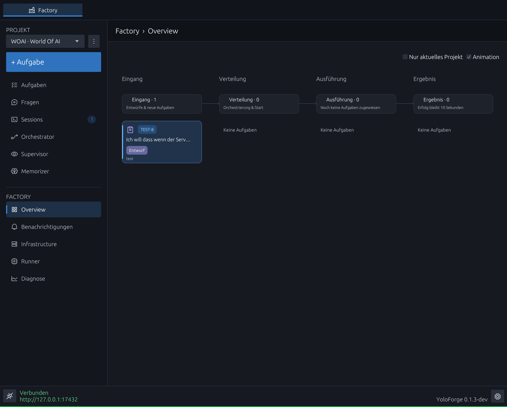
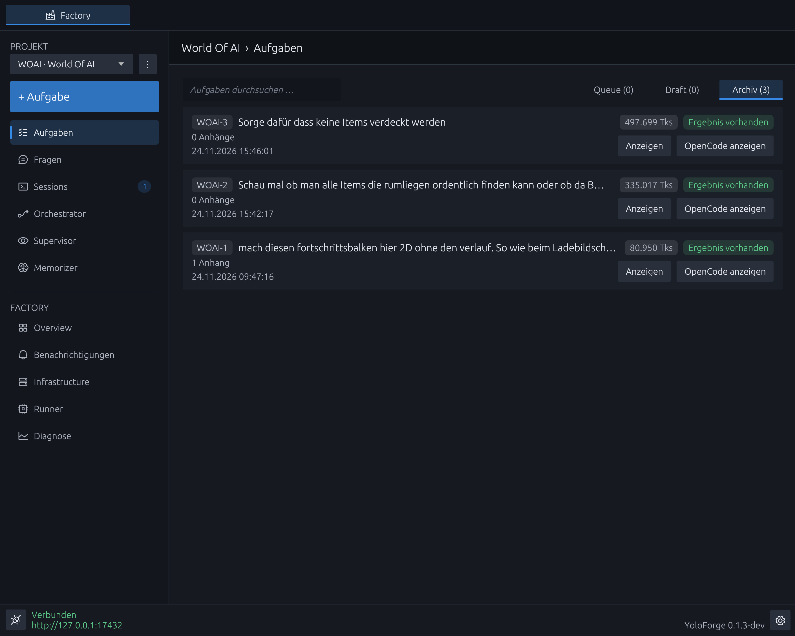
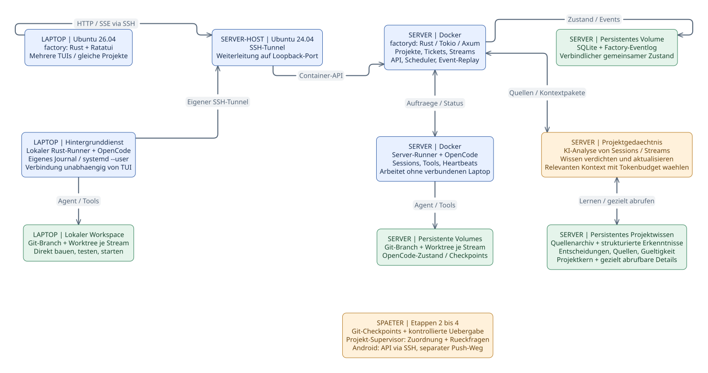

# YoloForge


Repository: https://github.com/farion/yoloforge

Der CLI-Einstieg heißt `yoloforge`. `factory` bleibt als kompatibler Alias
verfügbar; interne `factory-*`-Crates, Protokollkennungen und vorhandene Datenpfade
bleiben kompatibel. Veröffentlichung: Commit → Tag → Push → GitHub Release.
Die Installation auf dem Server erfolgt ausschließlich durch das Ansible des
Betreibers. Siehe [Deployment](docs/deployment.md).

Persönliche Entwicklungs-Factory zur Verwaltung paralleler OpenCode-Arbeitsstreams.
Ein zentraler Rust-Dienst verwaltet Projekte und Aufgaben; Agenten arbeiten auf
dem Laptop oder Server. Die native [Rust-/egui-GUI](docs/gui.md), die
Ratatui-Oberfläche und die Android-App bedienen denselben Zustand.

## Native Desktop-GUI (Linux, macOS, Windows)

```sh
cargo build --locked -p factory-gui -p factory-runner
cargo run --locked -p factory-gui --bin yoloforge-gui
```

### Speicherbedarf von Rust-Builds

Lokale Entwicklungs- und Test-Builds verwenden reduzierte Debug-Informationen
(`profile.dev.debug = 1`); inkrementelles Kompilieren bleibt lokal aktiv.
Verwaltete Runner geben ihren OpenCode-Unterprozessen für Cargo die Profile
`DEV` und `TEST` mit `DEBUG=0` und `INCREMENTAL=false` mit. Diese Vorgaben gelten
nach Neubau und Neustart des Runners auch für seine Agenten-Builds.
Release-Profile bleiben unverändert.

Vorhandene Builddateien werden durch die Profiländerung nicht gelöscht.
`cargo clean` entfernt sie, aber auch die gebauten Programme; daher nur ohne
laufende Builds und mit anschließendem Neubau verwenden. Workspaces und
unveröffentlichte Änderungen niemals zum Aufräumen löschen.
Entwicklungs-/Testskripte ermitteln den Buildordner über `cargo metadata`;
`CARGO_TARGET_DIR` und Cargos `build.target-dir` werden dadurch berücksichtigt.
GUI, Server und Runner müssen gemeinsam gebaut werden: Die GUI startet ihre
Hilfsprogramme neben ihrer eigenen Programmdatei, unabhängig vom Buildordner.
Verwaltete Runner reichen ein geerbtes `CARGO_TARGET_DIR` an ihre isolierte
Laufzeit weiter. Bei einer isolierten Laufzeit genügt eine persönliche
`~/.cargo/config.toml` allein nicht, da sie ein separates `HOME` hat.
Ein gemeinsamer Ordner spart wiederverwendbare Abhängigkeiten, ist aber nicht
größenbegrenzt. Gleichnamige Programme verschiedener Worktrees teilen sich dort
den Ausgabepfad; vor dem Start immer den gewünschten Stand bauen.
Bei einem gemeinsamen Ordner betrifft ein unbeschränktes `cargo clean` auch
Builddateien anderer Projekte. Nicht während fremder Builds bereinigen.

Dark Theme, Aufgaben-/Fragenverwaltung, schreibgeschützte OpenCode-Tabs,
Instanzpräsenz, Orchestrator, Runner, Diagnose und globale Benachrichtigungen.
Ohne Zugang öffnet sich ein Verbindungsdialog mit lokalem Startassistenten.
[Bedienung und Grenzen](docs/gui.md) · [Funktionszuordnung](docs/gui-parity.md).

GitHub CI baut GUI und Runner für Linux/macOS (x86-64 und ARM64) und Windows
(x86-64), dazu Server-Pakete für Linux. Versionstags veröffentlichen nur vollständige
Paketsets mit Prüfsummen. [CI und Releases](docs/ci.md).

### Screenshots





## Ausprobieren

Version 0.1.0 ist eine frühe nutzbare Grundlage, nicht der Abschluss aller
15 Arbeitspakete. Gerätezugang, SSE, Docker und Backup/Restore sind implementiert.
Supervisor samt autonomer Compaction/Sessionbeendigung, automatische Wissensextraktion,
Checkpoint-Transfer und Android folgen. Aktueller
[Umsetzungsstand](docs/implementation-status.md).

Server, Runner und Ratatui laufen; Projekte und Tickets werden mit SQLite persistiert:
[Build, Startanleitung und Tests](docs/development.md).

```sh
cargo build --workspace --locked
python3 -u scripts/smoke-foundation.py
```

## Architektur und Planung



[SVG](docs/architecture.svg) · [PNG](docs/architecture.png) ·
[Editierbare LAML-Quelle](docs/architecture.laml)

Blau: MVP-Prozesse · Grün: persistente Daten · Orange: spätere Erweiterungen.
Runner und OpenCode sind zur Übersicht je Ausführungsort zusammengefasst,
bleiben aber getrennte Prozesse. Pro Stream schreibt nur ein Runner.

- [Architektur und MVP](docs/architecture.md)
- [Datenmodell und Runner-Protokoll](docs/protocol.md)
- [Zugang, Verbindungen und Deployment](docs/access-and-deployment.md)
- [Umsetzungstickets und Abnahme](docs/backlog.md)
- [Umsetzungsplan für die native Rust-/egui-GUI](docs/gui-plan.md)
- [Repository klonen, registrieren und aktualisieren](docs/repositories.md)
- [Projektgedächtnis und begrenzte Kontextauswahl](docs/knowledge.md)
- [Nachrichtenarchiv und Export](docs/session-archive.md)
- [Geräteverwaltung in der TUI](docs/device-tui.md)
- [Autonomer Session-Supervisor](docs/supervisor.md)
- [Server-Erstabnahme rs9tm](docs/server-acceptance.md)

Status: Rust-Verbindungsdurchstich (F-101), persistente Projekt-/Ticketverwaltung
(F-102), Streams mit persistenter Auftragswarteschlange und verifizierter
[OpenCode-Spike](spikes/opencode/README.md). Runner journalisieren Aufträge und
Ergebnisse lokal, legen isolierte Git-Worktrees an und führen dort OpenCode-Agenten
mit Projektprofilen aus (F-105 / Teil F-106). Zwei parallele schreibende Agenten
und Wiederanlauf während aktiver Tools sind im Labor geprüft. Agentenfragen und
Permissions können über die CLI oder direkt in Ratatui beantwortet werden:
`6` → Frage auswählen → `Enter` → `Ctrl-S`. In `2`/`3`/`4` legt `n` Projekte,
Tickets und Streams an; `Enter` öffnet Profil-, Ticket- oder Streamdialoge.
`e` in der Projektliste bearbeitet bestehende Metadaten.
`5` → `Enter` zeigt Auftragsdetails, Prompt, Profil, Factory-Ereignisverlauf und
gespeicherte Sessionauszüge mit Text-/Toolausgaben und sichtbaren Kürzungen.
Persistente Pausewünsche sind vorhanden; bestätigte Pause laufender Prozesse folgt.
