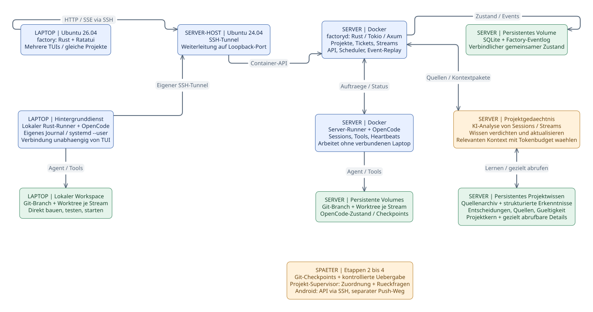

# Architektur und MVP

[LAML-Quelle](architecture.laml) · [PNG](architecture.png)

Die Übersicht fasst Runner und OpenCode je Ausführungsort zusammen; sie sind
separate Prozesse. Blau zeigt MVP-Prozesse, Grün persistente Daten, Orange die
späteren Erweiterungen. Verbindungslinien zeigen Kommunikation. Insbesondere
erteilt ein Verbindungsabbruch keinem zweiten Runner Schreibrechte.

## Ziel und feststehende Anforderungen

- Eine Person mit mehreren Projekten und parallelen Arbeitsstreams.
- Laptop: Ubuntu 26.04; Server: Ubuntu 24.04.
- Zentraler Rust-Dienst in Docker, lokale Rust-TUI mit Ratatui.
- Remote-Zugang über SSH zum Host und von dort zum Container.
- Mehrere TUIs dürfen dasselbe Projekt gleichzeitig bedienen.
- Agenten laufen von Anfang an lokal und auf dem Server.
- Lokale Workspaces ermöglichen direkte Builds, Tests und Anwendungsstarts.
- Später: kontrollierte Übergabe laufender Arbeit, Projekt-Supervisor und Android-App mit Push.

## Komponenten

| Komponente | Verantwortung |
| --- | --- |
| `factoryd` | Verbindlicher Factory-Zustand, API, Scheduling, Ereignisse, Runner-Zuordnung |
| `factory-runner` | Aufträge ausführen, Workspaces und OpenCode-Anbindung verwalten, Ergebnisse melden |
| `factory` | CLI/Ratatui-Client, Verbindungsverwaltung, Projekt- und Streambedienung |
| OpenCode-Service | Sessions, Modellzugriff, Tool-Ausführung und Agentenkontext |
| Android-App (später) | Mobile Bedienung und zentrale Fragen-Inbox |

Runner und OpenCode-Service existieren jeweils lokal und auf dem Server.
Eine TUI besitzt weder einen Stream noch einen Agentenprozess.
Der lokale Runner läuft als `systemd --user`-Dienst unabhängig vom TUI-Prozess.

### Technische Vorschläge

- Rust, Tokio, Axum, Serde; Ratatui/Crossterm für die Oberfläche.
- SQLite mit Migrationen für den zentralen Zustand; ausschließlich `factoryd`
  greift auf diese Datenbank zu.
- HTTP/JSON für Befehle und Snapshots, SSE für Factory-Ereignisse.
- Runner holen Befehle per Long-Poll und melden Zustandsänderungen per HTTP.
- OpenCode hinter einem versionierten Adapter statt direkter API-Abhängigkeiten
  in Fachlogik und TUI.
- Git über das installierte CLI; intern verwaltetes Bare-Repository je Projekt
  als Checkpoint-Austauschpunkt, getrennt vom optionalen Upstream.

Diese Auswahl ist noch keine Zusage über bereits getestete Kompatibilität.

## Deployment und Verbindung

Der detaillierte Einrichtungs- und Release-Vertrag steht in
[Zugang, Verbindungen und Deployment](access-and-deployment.md).
SSH-Host, öffentliche Geräteschlüssel und Ansible-Updates verwaltet der Betreiber.
Die Factory verwaltet eigene Geräteidentitäten und wiederverwendbare Anbieter-
verbindungen pro Ausführungsort; die TUI richtet fehlende Projektzugänge gezielt ein.

Das erste Server-Deployment enthält `factoryd`, Server-Runner und OpenCode.
Ob sie in einem Image oder getrennten Compose-Services laufen, entscheidet der
Spike anhand des Prozess-Lifecycles. Alle sind unabhängig von SSH-Sitzungen.

Persistente Volumes enthalten Factory-Datenbank, Repositories/Worktrees und
OpenCode-Zustand. Zugangsdaten werden getrennt von Git-Checkpoints bereitgestellt.

Der API-Port wird ausschließlich an Host-Loopback veröffentlicht. Die lokale
Verbindung läuft durch einen SSH-Tunnel zum Host. Im Container läuft kein SSHD.
SSH-Hostprüfung bleibt aktiv; Geräte erhalten eigene widerrufbare API-Tokens.

Der lokale Runner baut seine Verbindung selbst auf. Der Laptop benötigt keinen
eingehend erreichbaren Dienst. Runner und TUI dürfen nicht vom Tunnel-Lifecycle
eines einzelnen TUI-Fensters abhängen: der Runner besitzt seine eigene Verbindung.

Git-Transport zum internen Repository muss denselben SSH-Zugang nutzen. Der Spike
prüft einen eingeschränkten Host-Helper, der Git-Aufrufe an das Container-Repository
weiterreicht; allgemeiner Docker-Zugriff für Clients ist nicht erforderlich.

## Fachliche Regeln

1. Ein Projekt besitzt Tickets und Streams.
2. Ein Stream bündelt zusammengehörige Tickets und besitzt einen Branch sowie
   einen Worktree am aktiven Ausführungsort.
3. Ein Stream kann nacheinander mehrere OpenCode-Sessions haben.
4. Pro Stream existiert höchstens ein aktiver schreibender Runner.
5. Verschiedene Streams dürfen parallel am selben Projekt arbeiten.
6. Der Server entscheidet über Zuordnung und Zustandsübergänge; Clients sind Ansichten.
7. Ein beantwortetes Formular oder ein erneut gesendeter Befehl wird nicht doppelt ausgeführt.
8. Agentenabschluss bedeutet zunächst Review, nicht automatisch integrierte Arbeit.

## Lokale Entwicklung

Der lokale Agent arbeitet im lokalen Stream-Worktree. Die TUI zeigt dessen Pfad
und Start-/Testbefehle. Für manuelle Bearbeitung gibt es eine bestätigte Pause,
die auch aktive schreibende Tools berücksichtigt.

Interaktives Starten während Agentenänderungen ist möglich, liefert aber keinen
reproduzierbaren Teststand. Verbindliche Testresultate referenzieren einen
Checkpoint oder einen eindeutig identifizierten Workspace-Snapshot.

Projektkonfiguration beschreibt Toolchain, Systemabhängigkeiten, Build-/Test-/
Startbefehle und benötigte Umgebungsvariablen. Dateien wie `rust-toolchain.toml`
und Lockfiles bleiben im Repository. Build-Artefakte wie `target/` werden nicht
zwischen Ubuntu-Versionen übertragen.

## Checkpoints und Übergabe (Etappe 2)

Checkpoints enthalten Commit-ID, Ticketstand, Entscheidungen, offene Fragen,
Umgebungsanforderungen und Übergabezusammenfassung. Relevante unversionierte
Dateien müssen bewusst aufgenommen werden; ignorierte Dateien, Secrets und
Laufzeitdaten werden nicht pauschal übertragen.

Übergabe: Quell-Runner stoppen → Ende schreibender Tools bestätigen → Checkpoint
übertragen → Ziel vorbereiten → Zuständigkeit atomar wechseln → Ziel starten.
Die Übertragung wird als persistenter Vorgang mit wiederaufnehmbaren Schritten
modelliert. Ein Fehler vor dem Zuständigkeitswechsel aktiviert nicht den Ziel-Runner.

Ein Verbindungsabbruch ist keine bestätigte Übergabe. Der Server markiert einen
Runner als nicht erreichbar und startet keinen Ersatzschreiber für dessen Stream.
Der Runner nimmt offline keine neuen Aufträge an und versucht aktive Arbeit
kontrolliert zu unterbrechen. Ein ausgeschalteter Laptop kann ungesicherte lokale
Änderungen nicht mehr übertragen.

Session-Export/-Import ist in OpenCode V2 experimentell und muss geprüft werden.
Die robuste Alternative ist eine neue Session mit Checkpoint und Übergabepaket.
Laufende Prozesse, Terminals und lokale Dienste werden nicht migriert.

## Projektgedächtnis

Das projektbezogene Gedächtnis ist eine eigene logische Fähigkeit neben dem
Supervisor, zunächst innerhalb des Server-Deployments. Es muss kein separater
Prozess sein. Es steht lokalen und serverseitigen Runnern über `factoryd` zur
Verfügung und ist unabhängig von einzelnen OpenCode-Sessions.

Drei Ebenen trennen Aufbewahrung und Modellkontext:

1. **Quellenarchiv:** Sessionverläufe, Tickets, Stream-Ergebnisse und Codebezüge.
2. **Projektwissen:** verdichtete Entscheidungen, Konventionen, technische
   Erkenntnisse, Erfahrungen und offene Fragen mit Quellen und Gültigkeit.
3. **Arbeitskontext:** kleiner Projektkern und aufgabenbezogenes Wissenspaket
   innerhalb eines festen Tokenbudgets; Details werden gezielt nachgeladen.

Eine inkrementelle KI-Analyse läuft bei Checkpoints, Entscheidungen und
Stream-Abschlüssen. Sie extrahiert Kandidaten, vergleicht bestehendes Wissen,
verknüpft Quellen und markiert Widersprüche oder überholte Aussagen. Bestätigte
Nutzerentscheidungen, Testergebnisse und Agentenvermutungen bleiben unterscheidbar.
Branchbezogene Erkenntnisse werden nicht automatisch projektweit gültig.

Die Kontextauswahl berücksichtigt Aufgabe, Komponenten, Gültigkeit, Verbindlichkeit
und Redundanz. Zusammenfassungen ersetzen die Originalquellen nicht. Nutzer können
Wissen korrigieren, anheften oder löschen; Secrets werden nicht als Wissen übernommen.

Im MVP werden Quellen und Codebezüge sowie ein kuratierter Projektkern gespeichert.
Automatische Verdichtung und budgetierte Retrieval-Auswahl folgen inkrementell.
Das Diagramm kennzeichnet diese Automatisierung orange; der Speicher ist persistent.

## Supervisor (Etappe 3) – Verhalten

Ein deterministischer Scheduler reagiert auf Ereignisse und gleicht regelmäßig
den Zustand ab. Ein projektbezogener LLM-Supervisor unterstützt gezielt bei
Ticket-Zuordnung und fachlichen Rückfragen.

Neue Aufgaben werden anhand von Ziel, Abhängigkeiten, Streamkontext und Kapazität
zugeordnet oder zurückgestellt. Bestehende Sessions erhalten Folgeaufgaben
standardmäßig in einer Warteschlange. Jede Entscheidung wird begründet gespeichert.

Projektregeln und dokumentierte Entscheidungen bilden die Antwortgrundlage.
Unklare Produktentscheidungen kommen in die menschliche Inbox. Tool-Berechtigungen
bleiben von fachlichen Antworten getrennt und folgen expliziten Regeln.
Parallelitäts-, Kosten- und Wiederholungslimits verhindern unbegrenzte Schleifen.

## Android (Etappe 4)

Status, Tickets, Fragen, Pause und Fortsetzung nutzen dieselbe API. Verbindung im
Vordergrund über SSH; Push über einen separaten Anbieter/Transport. FCM versus
UnifiedPush/ntfy bleibt offen. Push enthält nur eine knappe Referenz; der aktuelle
Zustand wird nach dem Öffnen abgerufen. Die Server-Inbox bleibt verbindlich.

## MVP-Grenze

Etappe 1 enthält beide Runner, mehrere Projekte/TUIs, manuelle Tickets und Streams,
Worktrees, Sessionverlauf, Rückfragen, explizite Berechtigungsantworten, Pause sowie
Wiederverbindung. Kein automatischer Runner-Wechsel, autonomer Supervisor,
vollständiger Offline-Betrieb oder Android-Client.

## API-Grundlage und offene Prüfungen

Planungsgrundlage: OpenCode V2, konkrete Version im Spike festzulegen.

- https://opencode.ai/v2/docs/api
- https://opencode.ai/v2/docs/build/client

Dokumentiert sind Sessions, Prompts, Events, Forms, Permissions und Worktrees.
Event-Abonnements sind live-only; Factory-Ereignisse müssen selbst persistiert
und nach Wiederverbindung durch einen Zustandsabgleich ergänzt werden.
Exakte Payloads, Authentifizierung und Unterbrechungssemantik werden gegen die
OpenAPI-Spezifikation der tatsächlich eingesetzten Version verifiziert.
